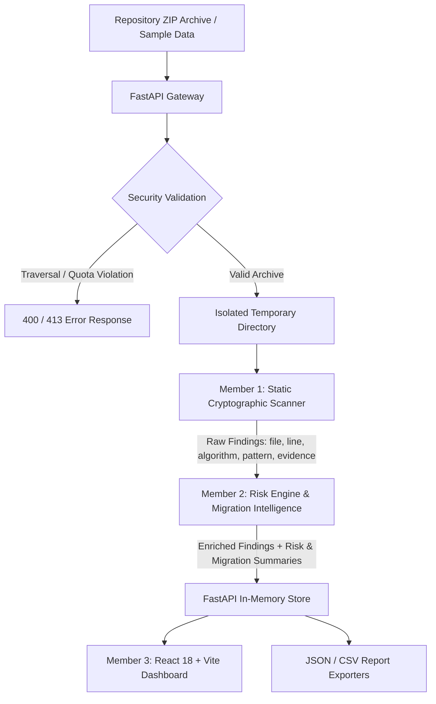

# QuantumShield — Cryptographic Inventory & Post-Quantum Migration Planner

**Qiskit Fall Fest 2026 (QFF 2026) Hackathon Submission**  
**Track:** Post-Quantum Cryptography  
**Problem Statement:** PS-P2 — Crypto Inventory & Migration Planner  
**Team:** techxperts  
**Repository:** [https://github.com/codewithswastik13/techxperts](https://github.com/codewithswastik13/techxperts)  

---

## 1. Project Overview

As quantum computing architectures advance toward cryptanalytically relevant quantum computers (CRQCs), classical public-key cryptosystems—including RSA, Diffie-Hellman, and Elliptic Curve Cryptography (ECC)—face imminent vulnerability to Shor's algorithm. To avoid systemic cryptographic compromise, organizations must audit their codebases, catalog every cryptographic dependency, and plan structured transitions to National Institute of Standards and Technology (NIST) Post-Quantum Cryptography (PQC) standards.

**QuantumShield** is a static cryptographic discovery, risk assessment, and migration planning tool designed for developers, security auditors, and cryptographic migration teams. It analyzes source code repositories as raw text data without executing, compiling, or importing untrusted source files. The system builds a structured cryptographic inventory, categorizes cryptographic operations by risk level and functional purpose, flags ambiguous usage for manual review, and provides actionable, standards-aligned migration guidance (such as NIST FIPS 203 ML-KEM and FIPS 204 ML-DSA).

---

## 2. Problem Statement (PS-P2)

- **Selected Problem Statement:** PS-P2 — Crypto Inventory & Migration Planner
- **Core Challenge:** Organizations operate complex polyglot software environments containing embedded, undocumented classical cryptographic implementations. Manual code audits are time-consuming and error-prone, while automated migration requires distinguishing between different cryptographic purposes (e.g., key exchange vs. digital signatures) rather than applying naive search-and-replace rules.
- **Solution Scope:**
  - Automated static source scanning across Python, Java, and C/C++ source trees.
  - Identification of algorithms: RSA, generic ECC, ECDH, ECDSA, AES (128/256), and SHA-256.
  - Deterministic risk engine evaluating quantum vulnerability, cryptographic purpose, and migration urgency.
  - Interactive web dashboard with visual risk analytics, searchable finding tables, and purpose-aware migration timelines.
  - Report export in JSON and CSV formats for downstream governance and automated CI/CD integration.
- **Scope Limitations:**
  - Pattern matching is heuristic: dynamically constructed algorithm identifiers, reflection, macro indirection, and proprietary cryptographic wrappers require manual code review.
  - Findings reflect detection confidence and risk classification, not dynamic exploitability or compliance certification.

---

## 3. Key Features

- **Static Multi-Language Scanner:** Regex-based heuristic detection across `.py`, `.java`, `.c`, and `.h` source files with strict comment stripping to eliminate commented-out code and false positives.
- **Purpose-Aware Risk Classification:** Distinguishes between key encapsulation, digital signatures, symmetric encryption, and cryptographic hashing.
- **Manual Review Flagging:** Explicitly marks ambiguous patterns (such as generic ECC without specified operations or unidentified RSA contexts) for human security review.
- **Safe ZIP Upload Handling:** Implements defense-in-depth archive validation, including path traversal rejection, size quotas, entry limits, and guaranteed temporary file cleanup.
- **Interactive Visual Dashboard:** Built with React 18, Vite, and Recharts, providing risk distribution charts, algorithm breakdowns, and filterable finding tables.
- **Standardized Export:** Downloadable audit reports in structured JSON and formula-sanitized CSV formats.
- **Synthetic Ground-Truth Evaluation Suite:** Automated test suite verifying 100% agreement against a ground-truth dataset of 15 synthetic cryptographic scenarios.

---

## 4. Architecture

QuantumShield follows a modular, decoupled pipeline architecture:



### Data Flow Pipeline
1. **Input Stage:** The user uploads a source repository ZIP or selects the pre-bundled safe sample repository fixture through the React dashboard.
2. **Ingestion & Safety:** FastAPI validates archive integrity, confirms ZIP magic bytes, enforces quota limits (50 MB compressed, 200 MB extracted, 2000 entries max), and safely extracts allowed source files into an isolated temporary directory.
3. **Static Scanning:** Member 1's scanner parses files, strips single-line and inline comments, applies language-specific regex patterns, deduplicates matches, and extracts evidence lines.
4. **Risk Intelligence:** Member 2's risk engine normalizes algorithm names, infers cryptographic purpose from code context, assigns risk levels (`HIGH`, `MODERATE`, `LOWER`), calculates migration priorities, and attaches NIST-aligned migration recommendations.
5. **Presentation & Reporting:** Member 3's API aggregates summary metrics and serves them to the React web UI for rendering risk charts, finding tables, migration summaries, and CSV/JSON downloads.
6. **Teardown:** The temporary extraction workspace is deleted in a `finally` block regardless of whether scanning succeeds or encounters an error.

---

## 5. Technology Stack

### Backend
- **Language:** Python 3.10+ (tested on Python 3.12)
- **Web Framework:** FastAPI 0.115+
- **ASGI Server:** Uvicorn 0.34+
- **Multipart Form Parser:** python-multipart 0.0.20+
- **Testing:** Pytest 8.3+, Pytest-Asyncio 0.24+, AnyIO 4.0+, HTTPX 0.28+

### Frontend
- **Framework:** React 18
- **Build Tool:** Vite 5
- **Icons:** Lucide React
- **Data Visualization:** Recharts
- **Styling:** Custom CSS design system with CSS custom properties, responsive layout, and WCAG-accessible light editorial security theme

---

## 6. Cryptographic Detection and Risk Analysis

### Supported Languages and File Extensions
- **Python:** `.py`
- **Java:** `.java`
- **C / C++:** `.c`, `.h`

### Detected Algorithms & Post-Quantum Threat Matrix

| Algorithm | Classical Purpose | Quantum Threat Mechanism | Quantum Risk Level | Migration Direction & NIST Standard |
|---|---|---|---|---|
| **RSA** | Key Exchange / Encryption | Factoring via Shor's Algorithm ($O(\log^3 N)$) | `HIGH` | Evaluate **NIST FIPS 203 (ML-KEM)** for key exchange |
| **RSA** | Digital Signatures | Discrete log / Factoring via Shor's Algorithm | `HIGH` | Evaluate **NIST FIPS 204 (ML-DSA)** for digital signatures |
| **ECDH** | Key Establishment | Elliptic Curve Discrete Log via Shor's Algorithm | `HIGH` | Evaluate **NIST FIPS 203 (ML-KEM)** |
| **ECDSA** | Digital Signatures | Elliptic Curve Discrete Log via Shor's Algorithm | `HIGH` | Evaluate **NIST FIPS 204 (ML-DSA)** or FIPS 205 (SLH-DSA) |
| **ECC (Generic)** | Unclassified Public Key | Vulnerable to Shor's Algorithm | `HIGH` | Flagged for **Manual Review** to determine purpose |
| **AES-128** | Symmetric Encryption | Grover's Algorithm reduces effective security to ~64 bits | `MODERATE` | Migrate to **AES-256** for 128-bit quantum security margin |
| **AES-256** | Symmetric Encryption | Grover's Algorithm reduces effective security to ~128 bits | `LOWER` | **Retain AES-256**; public-key PQC replacement is not applicable |
| **SHA-256** | Cryptographic Hashing | Collision attacks via BHT; pre-image via Grover's | `LOWER` | **Retain SHA-256 / SHA-384**; assess separately from public-key migration |

> **Important Disclaimer:** Post-quantum migration recommendations are structural planning guides, not drop-in automatic replacements. Differences in public key sizes, ciphertext overhead, signature lengths, and protocol handshakes require thorough architecture and compatibility testing before deployment.

---

## 7. Team Contributions

QuantumShield was collaboratively developed by team **techxperts** for QFF 2026:

- **Member 1 (Anubhav Sharma / ace-0307): Cryptographic Scanner**
  - Architected the static scanning engine (`backend/scanner/scanner.py`).
  - Implemented language-specific regex rule sets (`backend/scanner/rules.py`) covering Python, Java, and C/C++.
  - Engineered comment stripping, same-line pattern deduplication, and file size / binary file filtering.
  - Authored scanner test suite (`backend/tests/test_scanner.py`).

- **Member 2 (Swastik Nandi / codewithswastik13): Risk Engine & Migration Intelligence**
  - Designed the deterministic quantum risk classification and rule model (`backend/risk_engine/rules.py`, `risk_engine.py`).
  - Implemented cryptographic-purpose inference, algorithm normalization, and manual-review heuristics.
  - Aligned migration recommendations with NIST PQC standards (FIPS 203 ML-KEM, FIPS 204 ML-DSA).
  - Built the synthetic ground-truth benchmark evaluation dataset and test suite (`backend/tests/test_evaluation.py`).

- **Member 3 (Anirban Khatua / devopswithanirban): Backend API & Frontend Dashboard**
  - Implemented the FastAPI web application, routing, and error handling (`backend/app/main.py`).
  - Built archive security protections (ZIP traversal guard, quota enforcement, guaranteed cleanup).
  - Developed the React 18 web dashboard, interactive risk charts, search/filter table, and migration timeline.
  - Created CSV/JSON report generators with formula injection protection and comprehensive API tests (`backend/tests/test_api.py`).

---

## 8. Repository Structure

```text
techxperts/
├── backend/
│   ├── app/
│   │   ├── __init__.py
│   │   ├── main.py                  # FastAPI application, routing, ZIP extraction
│   │   └── scanner_stub.py          # Fallback stub for modular development
│   ├── risk_engine/
│   │   ├── __init__.py
│   │   ├── risk_engine.py           # Classification & recommendation engine
│   │   └── rules.py                 # Risk levels, priorities, and rule definitions
│   ├── scanner/
│   │   ├── __init__.py
│   │   ├── rules.py                 # Multi-language regular expression patterns
│   │   └── scanner.py               # Repository walker, comment cleaner, extractor
│   ├── tests/
│   │   ├── fixtures/
│   │   │   └── synthetic_eval_cases.json  # 15 ground-truth test cases
│   │   ├── __init__.py
│   │   ├── test_api.py              # API endpoint, ZIP security & export tests
│   │   ├── test_evaluation.py       # Benchmark evaluation runner & assertions
│   │   ├── test_risk_engine.py      # Risk classification unit tests
│   │   └── test_scanner.py          # Static scanner unit & edge-case tests
│   ├── __init__.py
│   └── requirements.txt             # Python backend dependencies
├── frontend/
│   ├── public/
│   │   ├── favicon.svg              # QuantumShield shield icon
│   │   └── sample_repo.zip          # Safe sample archive served to browser
│   ├── src/
│   │   ├── components/
│   │   │   ├── Dashboard.jsx        # Landing view, metrics & capability cards
│   │   │   ├── FindingsTable.jsx    # Filterable, searchable inventory table
│   │   │   ├── Header.jsx           # Global navigation and API status pill
│   │   │   ├── MigrationPlanner.jsx # PQC migration timeline & guidance cards
│   │   │   ├── ResultsView.jsx      # Results container with tabbed navigation
│   │   │   ├── RiskCharts.jsx       # Recharts risk breakdown & bar visualizations
│   │   │   └── ScanWorkspace.jsx    # ZIP file dropzone & upload interface
│   │   ├── services/
│   │   │   └── api.js               # Frontend API client
│   │   ├── App.jsx                  # Main application orchestrator
│   │   ├── index.css                # Design system styling tokens & layout
│   │   └── main.jsx                 # React root entrypoint
│   ├── index.html
│   ├── package.json                 # Frontend dependencies and scripts
│   ├── package-lock.json
│   └── vite.config.js               # Vite config with API reverse proxy
├── sample/
│   ├── create_sample_zip.py         # Deterministic sample archive generator
│   └── sample_repo.zip              # Pre-built safe sample repository archive
├── sample_data/
│   ├── c/
│   │   ├── clean_sample.c
│   │   ├── crypto_sample.c
│   │   └── crypto_sample.h
│   ├── java/
│   │   ├── CleanSample.java
│   │   └── CryptoSample.java
│   └── python/
│       ├── clean_sample.py
│       └── crypto_sample.py
├── .gitignore
└── README.md
```

---

## 9. Prerequisites and Installation

### Prerequisites
- Python 3.10 or higher
- Node.js 18+ and npm 9+
- Git

### Installation Steps

1. **Clone the Repository:**
   ```bash
   git clone https://github.com/codewithswastik13/techxperts.git
   cd techxperts
   git checkout feature/risk-engine
   ```

2. **Backend Setup:**
   Create and activate a Python virtual environment:
   ```bash
   # Windows PowerShell
   python -m venv .venv
   .venv\Scripts\Activate.ps1

   # Linux / macOS
   python3 -m venv .venv
   source .venv/bin/activate
   ```

   Install backend dependencies:
   ```bash
   pip install -r backend/requirements.txt
   ```

3. **Frontend Setup:**
   In a separate terminal:
   ```bash
   cd frontend
   npm install
   ```

---

## 10. Running the Application

### 1. Start the Backend API
From the repository root with virtual environment activated:
```bash
python -m uvicorn backend.app.main:app --port 8000 --reload
```
- **Backend API Base:** `http://localhost:8000`
- **Interactive OpenAPI Docs:** `http://localhost:8000/docs`
- **API Health Endpoint:** `http://localhost:8000/api/health`

### 2. Start the Frontend Dev Server
From the `frontend/` directory:
```bash
npm run dev
```
- **Frontend Application:** `http://localhost:5173`

*(Note: The Vite development server automatically proxies `/api` calls to `http://localhost:8000`.)*

### 3. Production Frontend Build (Optional)
To verify or serve production assets:
```bash
cd frontend
npm run build
```
Build output is generated cleanly into `frontend/dist/`.

---

## 11. How to Use

1. **Open the Application:** Navigate to `http://localhost:5173` in your browser. Verify the header displays `API: Connected`.
2. **Scan Source Code:**
   - Click **"Scan a repository"** or select the **Scan** tab.
   - **Option A (Sample Test):** Click **"Try sample project"** to automatically load and scan the pre-configured safe sample archive containing Python, Java, and C cryptographic patterns.
   - **Option B (Custom Upload):** Drag and drop any repository `.zip` archive (max 50 MB) into the upload zone.
3. **Inspect Inventory & Findings:**
   - Navigate to the **Findings** tab to inspect file locations, exact line numbers, detected patterns, code evidence, and risk classifications.
   - Filter findings by Risk Level (`HIGH`, `MODERATE`, `LOWER`), Cryptographic Purpose, or Algorithm.
4. **View Visual Analytics:**
   - Navigate to the **Charts** tab to review risk distribution pie charts, algorithm frequency bar charts, and purpose breakdowns.
5. **Review Migration Roadmap:**
   - Navigate to the **Migration** tab to examine prioritized post-quantum replacement guidance, NIST FIPS standards alignment, and manual review action items.
6. **Download Reports:**
   - Use the **"Download JSON"** and **"Download CSV"** buttons in the header to save audit reports.

---

## 12. Testing and Evaluation

### Automated Backend Test Suite
Run the full pytest suite from the repository root:
```bash
python -m pytest backend/tests/ -v
```

**Verified Test Results:**
- **Total Tests:** 94 tests (93 passed, 1 skipped).
- **Scanner Unit Tests (`test_scanner.py`):** 19 tests covering multi-language detection, line accuracy, comment stripping, deduplication, binary file exclusion, and path boundaries.
- **Risk Engine Tests (`test_risk_engine.py`):** 19 tests verifying deterministic classification, purpose inference, and edge-case handling.
- **API & Security Tests (`test_api.py`):** 54 tests validating health check, upload safety, traversal prevention, ZIP bomb guards, cleanup, JSON/CSV exports, and error responses.
- **Evaluation Suite (`test_evaluation.py`):** 2 tests asserting 100% agreement against ground-truth benchmarks.
- *(Note: `test_symlink_outside_repository_ignored` gracefully skips on non-elevated Windows environments where symlink creation requires administrative privileges.)*

### Ground-Truth Benchmark Evaluation
QuantumShield includes a benchmark runner measuring agreement between the Risk Engine and 15 ground-truth cryptographic scenarios:
```bash
python -c "from backend.tests.test_evaluation import run_benchmark_evaluation; import json; print(json.dumps(run_benchmark_evaluation(), indent=2))"
```
```json
{
  "total_cases": 15,
  "field_matches": {
    "risk_level": 15,
    "cryptographic_purpose": 15,
    "migration_priority": 15,
    "manual_review_required": 15
  },
  "field_accuracies": {
    "risk_level": 100.0,
    "cryptographic_purpose": 100.0,
    "migration_priority": 100.0,
    "manual_review_required": 100.0
  },
  "overall_accuracy": 100.0,
  "mismatches": []
}
```
*Note: Synthetic benchmark metrics verify rule engine consistency and specification adherence across test fixtures; they do not represent guaranteed real-world scanning coverage.*

### Frontend Production Validation
```bash
npm --prefix frontend run build
```
Builds cleanly with zero errors across all 2,374 modules.

---

## 13. Security Design

QuantumShield implements defensive software practices for processing untrusted code archives:

1. **Static Analysis Only:** Uploaded code is parsed strictly as plain text using regular expressions. No user-supplied files are ever compiled, dynamically imported, or executed.
2. **ZIP Path Traversal Defenses:** Archive member paths are inspected before extraction; entries containing absolute paths or traversal sequences (`../`, `..\`) are rejected.
3. **Resource & Decompression Limits:**
   - Maximum upload size: 50 MB
   - Maximum uncompressed size: 200 MB
   - Maximum archive entry count: 2,000 files
   - Maximum individual file size: 5 MB
4. **Temporary Workspace Isolation:** Each scan extracts into an isolated UUID-prefixed temporary directory (`tempfile.mkdtemp`), guaranteed to be deleted in a `finally` block upon completion.
5. **CSV Formula Injection Neutralization:** All CSV export fields starting with spreadsheet formula triggers (`=`, `+`, `-`, `@`, `|`, `\t`) are escaped with a leading tab character.
6. **Information Disclosure Prevention:** File paths in responses and error messages are sanitized to prevent internal server directory leakage.

---

## 14. Limitations and Future Work

- **Static Heuristic Limitations:** Pattern matching cannot identify obfuscated calls, reflection, or dynamically constructed algorithm names.
- **In-Memory Scan Storage:** Completed scans are retained in memory for the duration of the server session (bounded to the 50 most recent scans). Persistent database storage (e.g., PostgreSQL or SQLite) is planned for enterprise production.
- **Broader Language Ecosystem:** Expanding parser support to Go, Rust, C#, PHP, and JavaScript/TypeScript.
- **Hybrid PQC Protocol Modeling:** Adding guidance for hybrid key-exchange mechanisms (e.g., X25519 + ML-KEM-768) and composite signature schemes during transitional deployment.

---

## 15. License and Acknowledgements

- **License:** All rights reserved by team **techxperts** for the Qiskit Fall Fest 2026 hackathon submission.
- **Acknowledgements:** Developed for **Qiskit Fall Fest 2026 (QFF 2026)** under Problem Statement **PS-P2: Crypto Inventory & Migration Planner**. Special thanks to the organizers, mentors, and the NIST Post-Quantum Cryptography Standardization project for guidance documentation.
